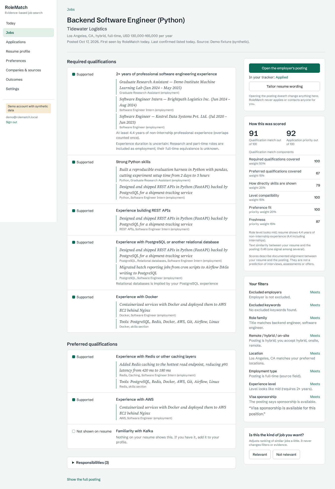

# RoleMatch

Resume-based job discovery and application tracking. Upload a resume, correct what was extracted, choose
preferences, and get openings from the companies you follow ranked by **documented** qualification fit — with
the resume line behind every claim, the requirements your resume doesn't show, and what the posting leaves unclear.

RoleMatch never predicts interview or offer odds and has no "ATS score". Scores describe how well your resume
documents a posting's requirements, and nothing more.



## What it does

- **Resume → editable profile.** PDF/DOCX/pasted text, extracted in a sandboxed subprocess. Every extracted item
  links back to its exact span in the resume. Fix titles, dates and item types, add skills you have, remove
  wrong ones; corrections are logged next to the original extraction. Projects and education never count as
  employment; overlapping jobs are counted once; year-only dates become ranges.
- **Jobs from sources you choose.** Public Greenhouse and Lever job boards for a company watchlist, manual entry
  (pasted text, or a Greenhouse/Lever link), and bundled synthetic fixtures for an offline demo.
- **Explainable matching.** Required vs. preferred qualifications, eligibility statements and responsibilities are
  extracted from each posting. Each requirement is *supported*, *partly supported*, *not shown on resume*, or
  *unclear*, with the resume excerpt. Hard filters exclude only on explicit conflicts; unknowns stay visible.
- **Tracker.** Saved → applied → OA → interview → offer (and rejected / withdrawn / closed), with append-only
  history, the resume version you submitted, a frozen copy of the posting, timezone-aware deadlines, reminders and
  `.ics` export. Nothing is ever submitted or sent for you.
- **Tailoring.** Suggests clearer wording for relevant bullets of your *verified* profile, shows the source line for
  each, and refuses any wording that adds skills, numbers or names. Saved as a separate version that never counts
  as matching evidence.

## Quick start

### Docker (full stack)

```bash
cp .env.example .env
docker compose up --build            # Postgres+pgvector, Redis, API, Celery worker/beat, web
docker compose exec api python -m app.cli seed
open http://localhost:3000           # "Open the demo account" on the sign-in page
```

The demo account (`demo@rolematch.local` / `demo-password-123`) uses a synthetic resume and 36 fictional
postings. It is for local use only; `python -m app.cli demo-reset` restores it.

### Without Docker

Requires Python 3.13, Node 22, PostgreSQL 16 with pgvector ≥ 0.5, and Redis (Redis is only needed for
background ingestion; set `ROLEMATCH_CELERY_EAGER=true` to run tasks inline).

```bash
# database (as a superuser, once)
createdb rolematch && psql -d rolematch -c "CREATE EXTENSION vector"

cd backend
python -m venv .venv && . .venv/bin/activate
pip install -r requirements-dev.txt
python scripts/fetch_model.py           # all-MiniLM-L6-v2 weights from Hugging Face (~90 MB)
python -m app.cli migrate && python -m app.cli seed
uvicorn app.main:app --port 8000

cd ../frontend && npm ci && npx next build && npx next start -p 3000
# optional: celery -A app.workers.celery_app worker -Q ingest,celery  /  celery -A app.workers.celery_app beat
```

### Following real companies

Add employers on **Companies & sources** (board type + identifier from the careers URL, e.g.
`boards.greenhouse.io/<identifier>` or `jobs.lever.co/<identifier>`), or list them in `config/watchlist.yaml`
and run `python -m app.cli sync-watchlist`. `python -m app.cli ingest --all` fetches immediately; Celery beat
refreshes every six hours.

## Supported sources and coverage limits

| Source | What it covers | Access |
|---|---|---|
| Greenhouse Job Board API | one employer's public board per identifier | public GET, no key ([docs](https://developers.greenhouse.io/job-board.html)) |
| Lever Postings API | one employer's public postings per site (US or EU) | public GET, no key (github.com/lever/postings-api) |
| Manual entry | anything you paste; Greenhouse/Lever links are fetched via their APIs | other URLs are never fetched |
| Demo fixtures | 36 synthetic postings | bundled |

**RoleMatch does not search the whole job market.** It only sees employers you follow plus jobs you add. It does
not scrape LinkedIn, Indeed or any site that requires a login, and it does not bypass CAPTCHAs or access controls.

Source behaviour: per-host rate limiting, timeouts, bounded retries with backoff (honouring `Retry-After`),
idempotent upserts keyed by source job ID, conservative cross-source dedup, and **outage-safe closing** (a job is
marked closed only after two consecutive *complete* listings omit it; failed or partial fetches never close jobs).
"Posted" dates come only from the source (Greenhouse `first_published`, Lever `createdAt`, with its caveat);
otherwise the UI shows when RoleMatch first saw the job.

## Architecture

A modular monolith:

```
frontend/            Next.js 16 (App Router), TypeScript, Tailwind 4 — proxies /api to the backend (first-party cookies)
backend/app/
  api/               FastAPI routers (auth, resumes, preferences, jobs, sources, applications, tailoring, account)
  services/resume/   sandboxed extraction, parser with offsets, overlap-aware experience
  services/jobs/     HTTP client, Greenhouse/Lever/fixture adapters, normalisation, ingestion, dedup, manual import
  services/matching/ requirement extraction, eligibility, profile, evidence evaluation, scoring/retrieval engine
  services/tracking/ stage history, deadlines, reminders, ICS, analytics
  services/          tailoring + claim checker, skill taxonomy, embeddings, URL safety, optional LLM provider
  workers/           Celery app + idempotent tasks
config/              skills taxonomy, role families, scoring weights, watchlist
fixtures/            synthetic resumes and jobs; schema-faithful API fixtures
eval/                personas, labels, extraction sets, evaluation script, results
```

Matching pipeline: requirement extraction (at ingestion) → hard/soft eligibility checks → candidate retrieval
(PostgreSQL full-text search + pgvector HNSW cosine search) → evidence-based reranking → explanations.
Details and trade-offs: [docs/DESIGN.md](docs/DESIGN.md).

## Tests and evaluation

```bash
cd backend && pytest                       # unit + integration tests against PostgreSQL (hashing embeddings)
cd frontend && npx playwright test          # end-to-end: upload → review → rank → evidence → apply → OA deadline
ROLEMATCH_LIVE_TESTS=1 ROLEMATCH_LIVE_GREENHOUSE_BOARD=<board> pytest -m live   # optional live smoke test
cd backend && python ../eval/run_eval.py    # offline evaluation (needs the MiniLM weights)
```

Evaluation on synthetic data (5 personas × 36 fictional postings, developer-written labels — see
[eval/README.md](eval/README.md) for protocol and limitations). Held-out split:

| Ranker | P@5 | nDCG@10 |
|---|---|---|
| Naive keyword matching | 0.440 | 0.844 |
| Semantic similarity only | 0.360 | 0.794 |
| Hybrid evidence-based (RoleMatch) | 0.520 | 0.959 |

Also measured: 0 of 716 evidence links failed the provenance audit; 0 of 42 shown jobs violated a hard filter;
required-qualification extraction F1 0.952 on a held-out hand-labelled set; ranking 36 jobs takes ~50 ms and
~536 jobs ~430 ms on 2 vCPUs. These are synthetic sanity checks, not evidence about hiring outcomes.

## Privacy and security

Argon2id passwords, opaque server-side sessions (httpOnly, SameSite=Lax cookie) plus a CSRF header, per-user
ownership checks returning 404 for other users' records, PII-redacting logs, uploads validated by magic bytes and
parsed in a resource-limited subprocess, SSRF-safe URL handling, private work-authorization storage, and full
account deletion (files included). Résumé and posting text is treated as data; instruction-like text is flagged
and removed before matching. See [docs/DESIGN.md](docs/DESIGN.md#privacy-and-security).

## Status: what is and isn't verified

Verified in the build environment: backend test suite, Alembic upgrade/downgrade and `alembic check`, frontend
type-check and production build, the Playwright end-to-end flow, the evaluation run, screenshots from the running
app, and `docker compose config`.

Not verified there (no network to these hosts / no Docker daemon):
- **Live Greenhouse and Lever calls.** Adapters are tested against fixtures built from the documented response
  shapes (`fixtures/recorded/README.md`). Run the live smoke test and `scripts/record_fixtures.py` on a networked
  machine.
- **Docker images and `docker compose up`.** Files are written and the Compose file validates.
- **Embedding parity with the reference implementation.** Evaluation used an fp16 copy of all-MiniLM-L6-v2 from
  the npm package `@lat.md/embed-minilm-fp16`; Docker/CI fetch the official weights. `scripts/verify_embedding_parity.py`
  (run in CI) compares RoleMatch's NumPy encoder with sentence-transformers.
- **The GitHub Actions workflow** has not run yet.

More: [deployment](docs/DEPLOYMENT.md) · [design](docs/DESIGN.md) · [demo script](docs/DEMO_SCRIPT.md) ·
[resume bullets](docs/RESUME_BULLETS.md) · [troubleshooting](#troubleshooting)

## Troubleshooting

| Symptom | Fix |
|---|---|
| `Embedding model not found` | `python backend/scripts/fetch_model.py`, or set `ROLEMATCH_EMBEDDING_MODEL_DIR` |
| `permission denied to create extension "vector"` | create it once as a superuser: `CREATE EXTENSION vector` |
| Jobs page says "Review your profile first" | open Resume profile and confirm a version |
| Jobs page is empty | follow a company (or the demo fixtures) on Companies & sources |
| Source shows "Repeatedly failing" / not found | check the board identifier in the employer's careers URL |
| Scanned PDF can't be read | upload a DOCX/text PDF or paste the text (no OCR by design) |
| Login returns 403 "Missing CSRF header" | call the API through the web app or send `X-RoleMatch-CSRF: 1` |
| Deadlines show the wrong time | set your time zone in Settings; deadlines keep the zone they were entered in |
